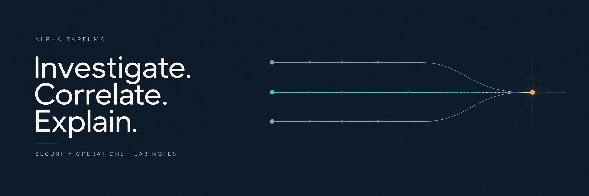

# 👋 Hi, I'm Alpha

**Aspiring SOC Analyst · Cybersecurity Lab Builder · Python & Linux Learner**

I'm building practical skills in security monitoring and investigation through a personal Wazuh and Kali Linux lab. My focus is on reading the evidence, correlating events, and explaining what the logs support.

I'm interested in **entry-level SOC and cybersecurity opportunities** where I can keep developing those skills. My programming, SQL, and web projects document the technical foundations behind that direction.

[LinkedIn](https://www.linkedin.com/in/alphatapfuma/) · [Email](mailto:alphatapfuma362a@gmail.com) · [Explore the portfolio](PORTFOLIO.md)

## 🛡️ Start with the security work

| Project | What to look for |
| --- | --- |
| **[SSH Login Investigation](https://github.com/KingAlpha362/ssh-login-investigation)** | Correlation of Linux authentication records with Wazuh alerts; source attribution, UTC alignment, and a conclusion that separates test activity from evidence of compromise. |
| **[Wazuh & Kali SOC Lab](https://github.com/KingAlpha362/wazuh-kali-soc-lab)** | File integrity monitoring, a Python file-activity simulation, and investigation notes on exposed services, authentication, and password hashes. |

## 💻 Selected software projects

These larger projects demonstrate application structure, data handling, and interface development alongside my security studies.

| Project | What to explore |
| --- | --- |
| **[Multi-Branch Banking Simulation](https://github.com/KingAlpha362/C---Bank-system)** | Modular C++ application with accounts, branches, transactions, file-backed records, and reporting. Educational simulation. |
| **[NeoVerse City Simulation](https://github.com/KingAlpha362/Console-Based-C-Game-Engine)** | Object-oriented city components, sensor data, STL containers, and event processing. |
| **[PennyWise](https://github.com/KingAlpha362/PennyWise)** | React finance interface with dashboard views, theme controls, and a simulated assistant. Mock-data prototype. |
| **[EPX Courier Website](https://github.com/KingAlpha362/EPX-Courier-website)** | React courier interface with coverage, branch-location, tracking-timeline, and reusable components. |

### 🔎 How I approach an investigation

1. **Establish context:** identify the host, activity, and collection source.
2. **Correlate evidence:** compare timestamps, source addresses, accounts, and alert details.
3. **Explain the outcome:** distinguish observations from assumptions and record limitations.
4. **Choose the next check:** document what would confirm or challenge the conclusion.

These projects are **educational lab work**. They show my learning process and analysis, rather than claims of production SOC experience.

## 🧰 Skills with examples

| Area | Evidence in this portfolio |
| --- | --- |
| **Security monitoring** | Wazuh alerts, file integrity monitoring, and Linux authentication events |
| **Investigation** | SSH log correlation, timestamp comparison, and contextual reading of MITRE ATT&CK mappings |
| **Python** | Controlled file-activity simulation, console applications, and object-oriented exercises |
| **SQL & data** | [Relational database modelling](https://github.com/KingAlpha362/coffee-shop-db) and [pandas notebook exercises](https://github.com/KingAlpha362/Data-Science-500) |
| **Programming foundations** | [C++ data structures](https://github.com/KingAlpha362/High-level-C--) and [modular application practice](https://github.com/KingAlpha362/C---Bank-system) |
| **Web development** | React interfaces and [personal portfolio source](https://github.com/KingAlpha362/kingalpha362.github.io) |

## 🗂️ Explore by interest

**[Security labs](PORTFOLIO.md#security-labs)** · **[Featured software](PORTFOLIO.md#featured-software-projects)** · **[Web projects](PORTFOLIO.md#web-projects)** · **[Data and analysis](PORTFOLIO.md#data-and-analysis)** · **[Programming](PORTFOLIO.md#programming)**

The portfolio leads with security investigations and larger applications. Supporting technical projects follow; introductory exercises are kept in the learning archive below.

## 🌱 What I'm working toward

- More reproducible lab investigations with clear timelines and documented test sources.
- Stronger Linux, networking, and Python foundations for defensive security.
- Concise investigation write-ups that make evidence easy for another analyst to review.

## 🤝 Connect

For entry-level opportunities, project feedback, or conversations about learning security operations, reach me on [LinkedIn](https://www.linkedin.com/in/alphatapfuma/) or by [email](mailto:alphatapfuma362a@gmail.com).

If the lab notes are useful, follow along as I add more investigations.

## 📚 Earlier learning & coursework

Explore introductory programming, HTML, Visual Basic, Excel, and Word projects

These early exercises show where I started. My current focus and larger projects appear above.

- [Programming and HTML exercises](PORTFOLIO.md#learning-archive)
- [Visual Basic salary calculator](https://github.com/KingAlpha362/Salary-calculator-VB)
- [Visual Basic hours-lived calculator](https://github.com/KingAlpha362/VB.Net-Program-to-Calculate-Hours-Lived)
- [Visual Basic delivery selector](https://github.com/KingAlpha362/Delivery-method)
- [Excel workbook practice](https://github.com/KingAlpha362/Introduction-to-Excel)
- [Excel and Word chart practice](https://github.com/KingAlpha362/EXCEL-2.0)
- [Word document design](https://github.com/KingAlpha362/Word-document)

[Browse the complete learning archive →](PORTFOLIO.md#learning-archive)

